# Diagrama entidad-relación (ERD)

Esquema lógico de CONTABDSI. Nota: se omiten las columnas de auditoría
(`creado_en`, `creado_por`, `actualizado_en`, `actualizado_por`, `version`)
y `eliminado_en` para legibilidad; todas las tablas las incluyen.

```mermaid
erDiagram
    companias ||--o{ compania_anios : "tiene"
    companias ||--o{ periodos_contables : "tiene"
    companias ||--o{ parametros_operacion : "configura"
    companias ||--o{ cuentas : "plan"
    companias ||--o{ terceros : "maestro"
    companias ||--o{ centros_costos : "maestro"

    compania_anios ||--o{ periodos_contables : "agrupa"

    cuentas ||--o{ cuentas : "padre/hija"
    cuentas ||--o{ conceptos_retencion : "cuenta"
    cuentas ||--o{ tarifas_iva : "cuenta"
    cuentas ||--o{ renglones_renta : "cuenta"
    cuentas ||--o{ plantilla_lineas : "usada en"
    cuentas ||--o{ formato_asignaciones : "asignada a"

    terceros ||--o{ tercero_etiquetas : "etiquetas"
    terceros ||--o{ lote_lineas : "referenciado"
    terceros ||--o{ documento_lineas : "referenciado"

    centros_costos ||--o{ lote_lineas : "referenciado"
    centros_costos ||--o{ documento_lineas : "referenciado"

    comprobantes ||--o{ consecutivos_comprobantes : "consecutivos"
    comprobantes ||--o{ lotes : "comprobante del lote"
    comprobantes ||--o{ documentos : "comprobante"

    lotes ||--o{ lote_lineas : "compone"
    lotes ||--o{ lote_validaciones : "valida"
    lotes ||--o{ documentos : "origina"

    documentos ||--o{ documento_lineas : "compone"
    documentos ||--o{ documentos : "reversión (documento_original_id)"

    documentos ||--o{ saldos_cuenta : "alimenta (derivado)"
    documentos ||--o{ saldos_cuenta_tercero : "alimenta (derivado)"
    documentos ||--o{ saldos_cuenta_centro : "alimenta (derivado)"
    documentos ||--o{ acumulados_tercero : "alimenta (derivado)"
    documentos ||--o{ acumulados_centro : "alimenta (derivado)"
    documentos ||--o{ acumulados_retencion : "alimenta (derivado)"
    documentos ||--o{ acumulados_iva : "alimenta (derivado)"

    formatos_exogenos ||--o{ formato_conceptos : "conceptos"
    formatos_exogenos ||--o{ formato_asignaciones : "cuentas"
    formatos_exogenos ||--o{ medio_filas : "reportado"
    generaciones_medios ||--o{ medio_filas : "genera"
    generaciones_medios ||--o{ medio_conciliaciones : "concilia"
    medio_topes ||--o{ medio_filas : "depura"

    companias ||--o{ procesos : "ejecuta"
    companias ||--o{ cierres : "cierra"
    companias ||--o{ consolidaciones : "consolida"
    companias ||--o{ presupuestos : "presupuesta"
    presupuestos ||--o{ presupuesto_rubros : "estructura"
    presupuesto_rubros ||--o{ presupuesto_valores : "12 meses"

    roles ||--o{ rol_permisos : "permisos"
    permisos ||--o{ rol_permisos : "otorga"
    roles ||--o{ usuarios : "asigna"
    usuarios ||--o{ auditoria : "registra"
    companias ||--o{ auditoria : "auditada"
    companias ||--o{ integraciones : "integra"
```

## Notas de diseño

- **Claves por compañía/año**: `lotes` y `documentos` llevan `UNIQUE (compania_id, anio, …)`.
- **Idempotencia**: `lotes.idempotency_key` y `documentos.idempotency_key` son `UNIQUE`.
- **Contabilización atómica**: `contabilizar_lote()` inserta documento/líneas y actualiza
  saldos/consecutivos dentro de una única transacción; ante cualquier error, rollback total.
- **Saldos derivados**: se regeneran desde `documento_lineas`; nunca se editan a mano.
- **Reversión**: `documentos.documento_original_id` enlaza el original con su reversión;
  el original pasa a estado `Anulado` y **no se borra**.
