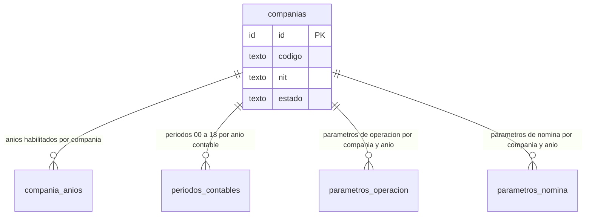
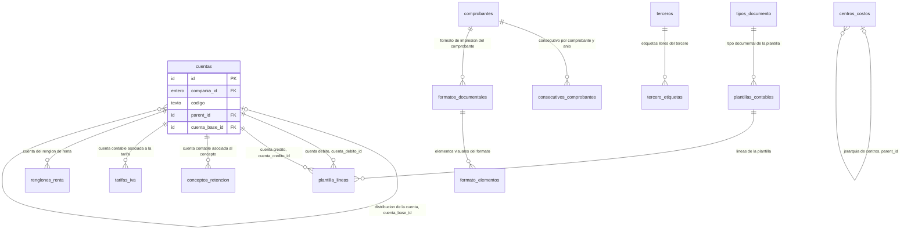
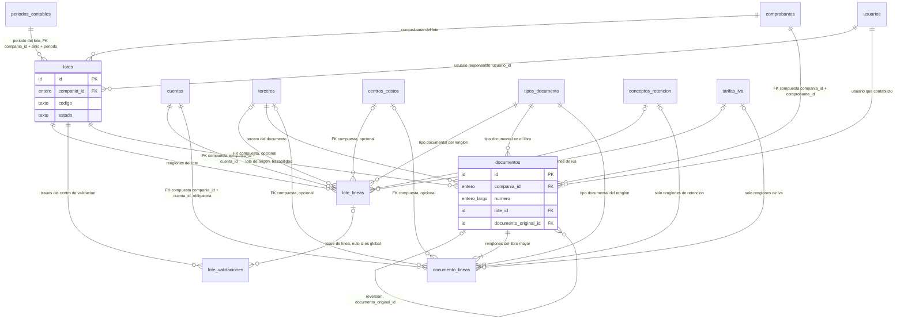
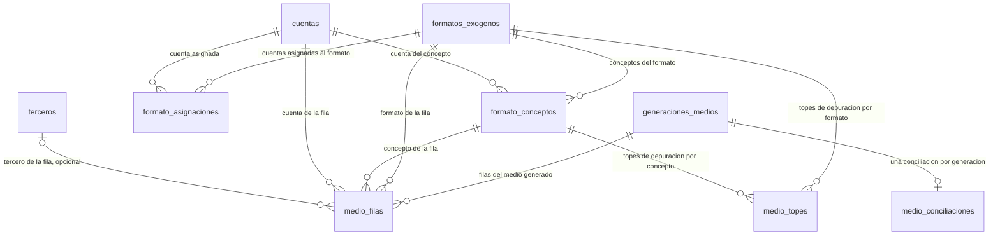
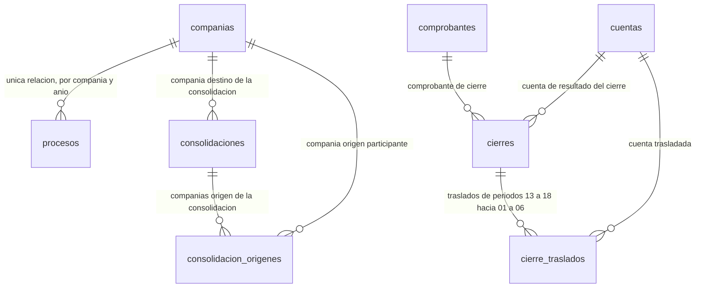
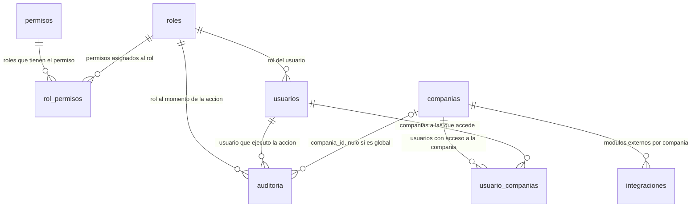
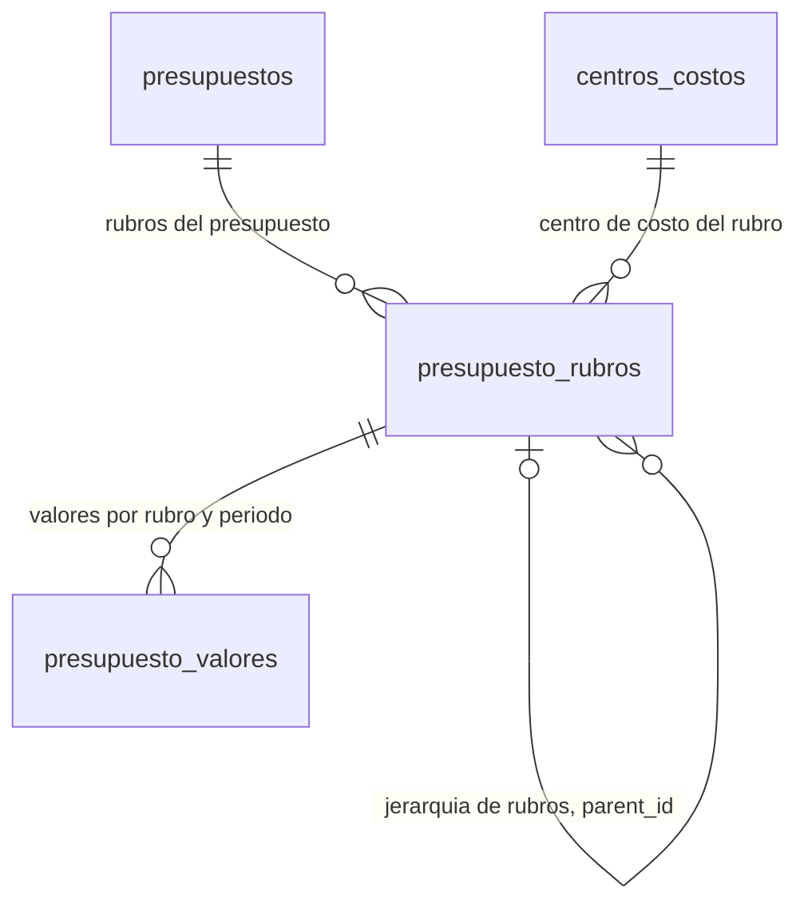
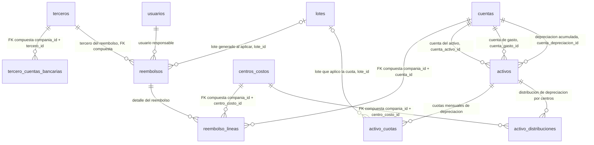

# Modelo lógico neutro — Diagrama entidad-relación

Complemento visual de [`01_entidades.md`](01_entidades.md), la fuente de verdad del diseño de datos: **las 60 entidades se muestran aquí únicamente con sus relaciones; los campos, tipos, UK, CHECK y reglas de cada una están en `01_entidades.md`**. No hay ninguna sintaxis propietaria de SGBD (ver [`00_convenciones.md`](00_convenciones.md)).

## Notas de lectura

- **Nueve diagramas, uno por módulo.** Las entidades llevan su nombre de tabla exacto, en minúsculas (igual que en los SQL). Cada bloque dibuja las relaciones internas del módulo y las relaciones con entidades de otros módulos que las declaran (p. ej. Movimientos referencia Maestros, Núcleo y Seguridad).
- **Aislamiento omitido para legibilidad.** El esquema es único y cada tabla lleva `compania_id`; las FK de línea → maestro son compuestas `(compania_id, id)`. El diagrama las dibuja como relaciones lógicas simples y *no* repite la arista genérica `compania_id` hacia `companias` en cada módulo: se dibuja solo en el Módulo 1 y, fuera de él, cuando es la única relación de la entidad (`estado_acumulaciones`, `procesos`, `integraciones`) o cuando la FK tiene significado de negocio propio (consolidaciones destino/origen, auditoría global, acceso de `usuario_companias`).
- **Cardinalidad estándar de Mermaid**: `||` exactamente uno · `|o` cero o uno · `o{` cero o más · `|{` uno o más · `o|` cero o uno. El símbolo del lado de cada entidad describe cuántas filas de *esa* entidad participan por cada fila de la otra (p. ej. `companias ||--o{ compania_anios`: cada año habilitado pertenece exactamente a una compañía; una compañía tiene cero o más años habilitados).
- **Relaciones etiquetadas** cuando hay ambigüedad o más de una relación entre la misma pareja: jerarquías por `parent_id`, `cuenta_base_id`, reversión `documento_original_id`, consolidación origen/destino, y las tres cuentas distintas que puede referenciar `activos`.
- **Sin atributos** salvo las claves mínimas de las cuatro entidades más centrales (`companias`, `cuentas`, `lotes`, `documentos`).

Módulos y cobertura:

| Módulo | Entidades |
|---|---|
| 1 Núcleo | `companias`, `compania_anios`, `periodos_contables`, `parametros_operacion`, `parametros_nomina` |
| 2 Maestros | `cuentas`, `terceros`, `tercero_etiquetas`, `centros_costos`, `comprobantes`, `consecutivos_comprobantes`, `tipos_documento`, `conceptos_retencion`, `tarifas_iva`, `renglones_renta`, `plantillas_contables`, `plantilla_lineas`, `formatos_documentales`, `formato_elementos` |
| 3 Movimientos | `lotes`, `lote_lineas`, `lote_validaciones`, `documentos`, `documento_lineas` |
| 4 Saldos | `saldos_cuenta`, `saldos_cuenta_tercero`, `saldos_cuenta_centro`, `acumulados_tercero`, `acumulados_centro`, `acumulados_retencion`, `acumulados_iva`, `estado_acumulaciones` |
| 5 Impuestos | `formatos_exogenos`, `formato_conceptos`, `formato_asignaciones`, `generaciones_medios`, `medio_filas`, `medio_topes`, `medio_conciliaciones` |
| 6 Procesos | `procesos`, `cierres`, `cierre_traslados`, `consolidaciones`, `consolidacion_origenes` |
| 7 Seguridad | `roles`, `permisos`, `rol_permisos`, `usuarios`, `auditoria`, `integraciones`, `usuario_companias` |
| 8 Presupuesto | `presupuestos`, `presupuesto_rubros`, `presupuesto_valores` |
| 9 Ampliaciones | `tercero_cuentas_bancarias`, `reembolsos`, `reembolso_lineas`, `activos`, `activo_cuotas`, `activo_distribuciones` |

## Módulo 1 — Núcleo

Los años habilitados, períodos y parámetros cuelgan directamente de `companias`. `periodos_contables` es referenciado a su vez por `lotes` (Módulo 3) con la FK compuesta `(compania_id, anio, periodo)`.

## Módulo 2 — Maestros

Catálogos del plan de cuentas, terceros, centros de costo, comprobantes, tipos documentales e impresos. `cuentas` es autorreferenciada dos veces: por `parent_id` (jerarquía del plan) y por `cuenta_base_id` (distribución); `centros_costos` por `parent_id`. `tipos_documento`, `comprobantes`, `cuentas` y `terceros` son referenciados por los módulos de movimiento, saldos, impuestos, procesos y ampliaciones (ver esos diagramas).

## Módulo 3 — Movimientos

El ciclo de captura (lotes y sus líneas validables) y el libro mayor (documentos contabilizados). Referencia Núcleo (`periodos_contables`), Maestros (`cuentas`, `terceros`, `centros_costos`, `comprobantes`, `tipos_documento`, `conceptos_retencion`, `tarifas_iva`) y Seguridad (`usuarios`). En los renglones, tercero y centro son opcionales según los flags `controla_tercero`/`controla_centro` de la cuenta, y concepto de retención/tarifa de IVA solo se llenan según la `clase` del renglón; las FK a esos maestros son compuestas `(compania_id, id)`. `documento_original_id` enlaza un comprobante con su reversión (nulo en el original).

## Módulo 4 — Saldos y acumulados

Tablas derivadas y regenerables: se reconstruyen desde `documento_lineas` (libro mayor, Módulo 3) con procesos de regeneración y no llevan FK entre sí. Solo referencian maestros por FK compuesta. `estado_acumulaciones` registra el último período acumulado por compañía/año/tipo y su única FK es `companias` (aislamiento); es uno de los pocos casos en que esa arista se dibuja fuera del Módulo 1.

```mermaid
erDiagram
  cuentas ||--o{ saldos_cuenta : "FK compuesta compania_id + cuenta_id"
  cuentas ||--o{ saldos_cuenta_tercero : "FK compuesta compania_id + cuenta_id"
  terceros ||--o{ saldos_cuenta_tercero : "FK compuesta compania_id + tercero_id"
  cuentas ||--o{ saldos_cuenta_centro : "FK compuesta compania_id + cuenta_id"
  centros_costos ||--o{ saldos_cuenta_centro : "FK compuesta compania_id + centro_costo_id"
  terceros ||--o{ acumulados_tercero : "acumulado anual por tercero"
  cuentas ||--o{ acumulados_tercero : "acumulado anual por cuenta"
  centros_costos ||--o{ acumulados_centro : "acumulado anual por centro"
  cuentas ||--o{ acumulados_centro : "acumulado anual por cuenta"
  terceros ||--o{ acumulados_retencion : "retencion acumulada por tercero"
  conceptos_retencion ||--o{ acumulados_retencion : "concepto de retencion"
  terceros ||--o{ acumulados_iva : "iva acumulado por tercero"
  tarifas_iva ||--o{ acumulados_iva : "tarifa de iva"
  companias ||--o{ estado_acumulaciones : "unica relacion, por compania y anio"
```

## Módulo 5 — Impuestos (información exógena)

`formatos_exogenos` define los formatos (1001, 1007, 2275…) con sus conceptos y asignaciones de cuentas; `generaciones_medios` produce los medios por compañía/año. Una generación tiene muchas filas editables y a lo sumo una conciliación. `medio_filas` y `medio_topes` referencian además a Maestros (`cuentas`, `terceros`).

## Módulo 6 — Procesos

Reprocesos, cierres y consolidación. `consolidaciones` apunta a la compañía destino (`compania_destino_id`, compañía de solo consolidación) y `consolidacion_origenes` lista las compañías origen participantes; por eso `companias` aparece aquí con sus dos aristas de negocio. `cierres` referencia `comprobantes` (comprobante de cierre) y `cuentas` (cuenta de resultado).

## Módulo 7 — Seguridad

Roles, permisos, usuarios y bitácora. `usuario_companias` y `integraciones` son los otros casos en que la FK a `companias` es relación de negocio (acceso del usuario a compañías; conexiones externas por compañía). `auditoria` referencia `companias` con nulo posible cuando el evento es global.

## Módulo 8 — Presupuesto

Presupuestos por compañía/año con rubros jerárquicos (Departamento → Grupo → Sección → Código, vía `parent_id`) ligados a centros de costo, y valores por rubro y período.

## Módulo 9 — Ampliaciones

Bancos de terceros, reembolsos de caja menor y activos fijos. `reembolsos` referencia Maestros (`terceros`, FK compuesta), Seguridad (`usuarios`) y, al aplicar, genera un `lote` (`lote_id` nulo hasta entonces). `activos` referencia tres cuentas distintas del plan; `activo_cuotas` es aplicada por un `lote` opcional y `activo_distribuciones` reparte la depreciación por centros de costo.

