# CONTABDSI · Migración de la base de datos
## De VISION/FORTUNER (Advantage ADS) al nuevo esquema PostgreSQL

---

## 0 · La idea en una lámina

- El legado: **tablas planas** sobre Advantage (ADT/DBF), una **carpeta por empresa**, una **tabla por mes** (`MOV00…MOV18`) y una **tabla por lote** (`MC<lote>`).
- El nuevo esquema: **60 entidades relacionales en 9 módulos**, aislamiento por `company_id`, libro inmutable, saldos que se recalculan.
- La migración: **transformación por proceso contable** (no volcado de archivos), con conciliación de diferencia cero.

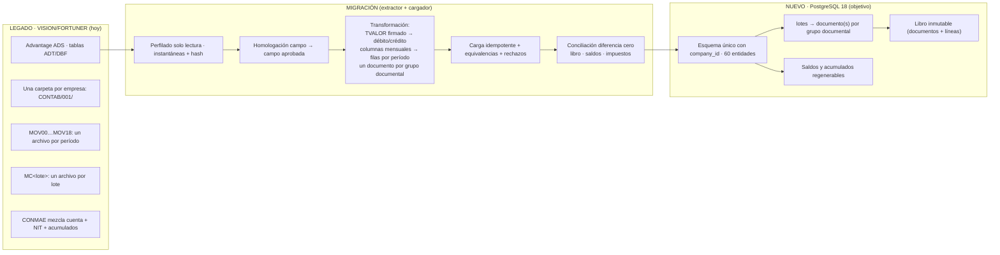

**Números que importan:** 98 familias funcionales (141 variantes físicas, 3.616 campos) → 60 entidades nuevas · 19 archivos `MOVxx` → 1 tabla · N archivos `MC<lote>` → 1 tabla · 15 bloqueos detectados (B01–B15) → corregidos y probados (11/11 pruebas).

---

## 1 · Cómo está hoy: el esquema legado

### 1.1 Qué quedó después de depurar el sistema

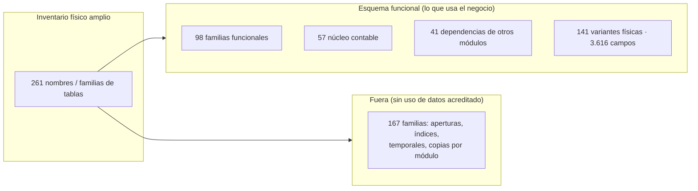

### 1.2 El flujo contable sobre esas tablas

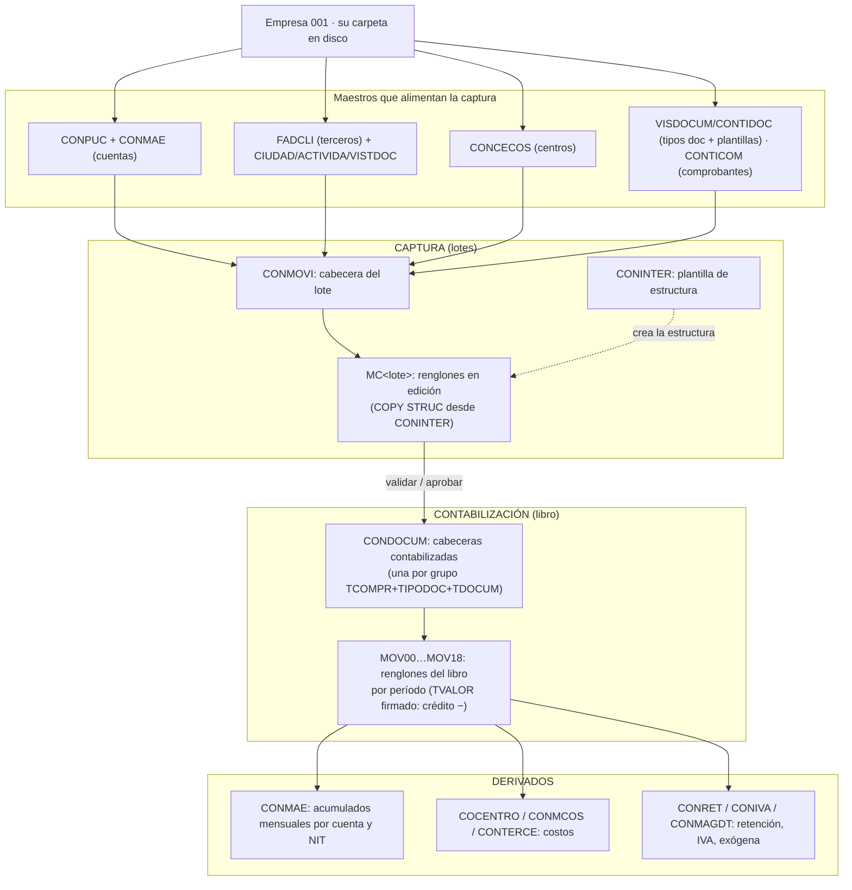

**Por qué no se puede "copiar" tal cual:**

- El aislamiento entre empresas es **físico** (carpeta), no una clave: no existen FKs.
- El mismo concepto vive en **N archivos** (por mes, por lote, por usuario).
- `TVALOR` es **firmado** (crédito negativo); hay columnas **mensuales** (`MACMDEB03`), porcentajes en dos formatos, NIT con ceros, `RECNO` que no es identidad estable.
- Tablas **polivalentes**: `CONMAE` = maestro + auxiliar + acumulados; `VISDOCUM` = tipo documental + consecutivo + plantillas.
- Marcas de borrado/anulación a interpretar **por entidad**, nunca con regla global.

---

## 2 · Cómo queda: el esquema nuevo

### 2.1 Arquitectura: un modelo neutro, implementaciones por motor

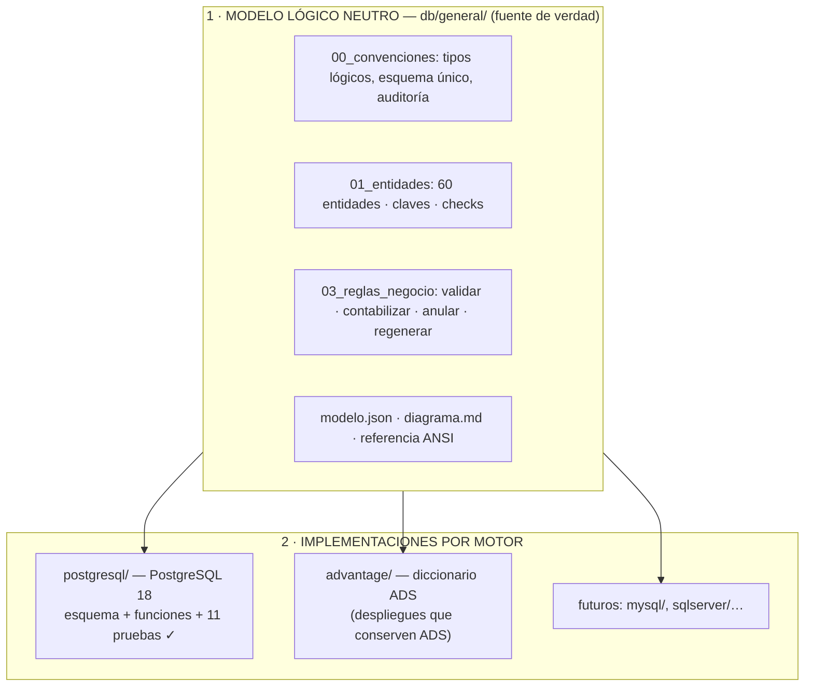

### 2.2 Las 60 entidades en 9 módulos

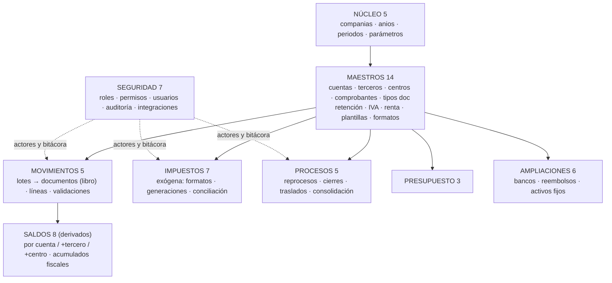

### 2.3 El flujo contable nuevo

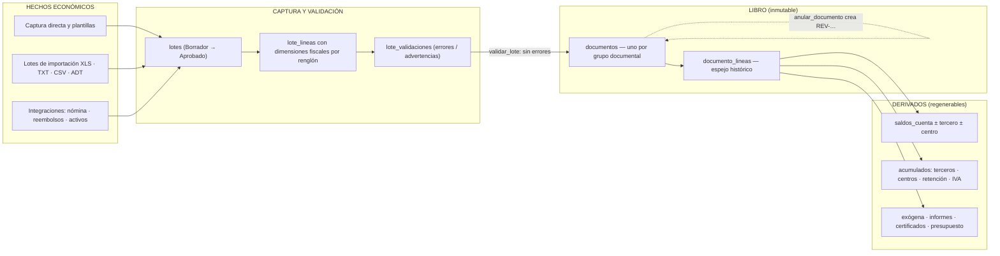

**Garantías nuevas (una línea cada una):** esquema único con `company_id` y FK compuestas (nada cruza entre empresas) · libro **inmutable** (corregir = anular con reversión `REV-…`) · saldos y acumulados **regenerables** desde el libro · auditoría + `version` en toda fila · idempotencia (un archivo no se carga dos veces) · B01–B15 corregidos y probados: **11/11 validaciones en verde**.

---

## 3 · Cómo conectan las tablas viejas con las nuevas

> Patrones: **N físicas → 1 lógica** (MOVxx, MC<lote>) · **1 polivalente → N entidades** (CONMAE, VISDOCUM) · **columnas mensuales → filas por período** (PRE05, MACMDEB03…) · la clave original de cada registro se conserva (equivalencias), nunca se renumeran documentos históricos.

### 3.1 Plan de cuentas, comprobantes y plantillas

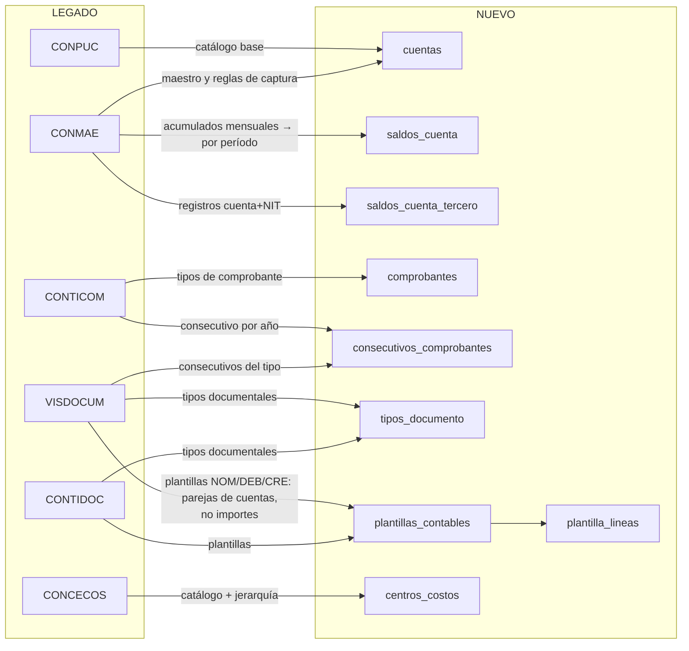

**Clave:** el tipo documental (NOM, FV…) es una dimensión del renglón, distinta del comprobante contable (CE, RC…). Las plantillas guardan **dos cuentas por regla** (débito/crédito), nunca importes fijos.

### 3.2 Movimiento: lotes, captura y libro (el corazón)

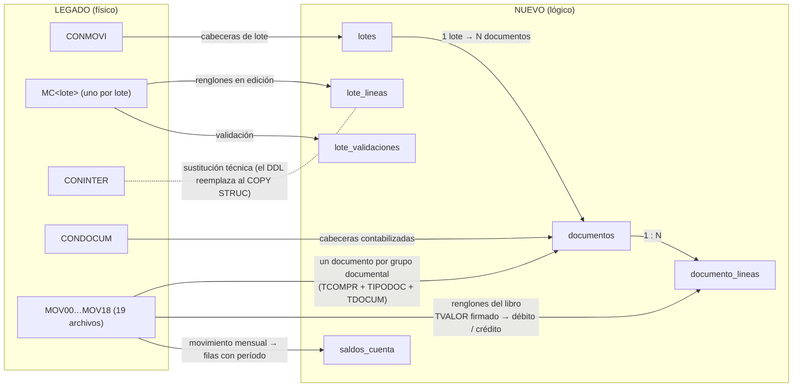

**Clave (B01):** el legado ya creaba **varias cabeceras CONDOCUM por lote** (agrupando por comprobante+tipo+documento); la primera versión del esquema nuevo aplanaba el lote a un documento. Corregido: `contabilizar_lote` crea **un documento por grupo documental**, como el original.

### 3.3 Terceros, cuentas bancarias y catálogos

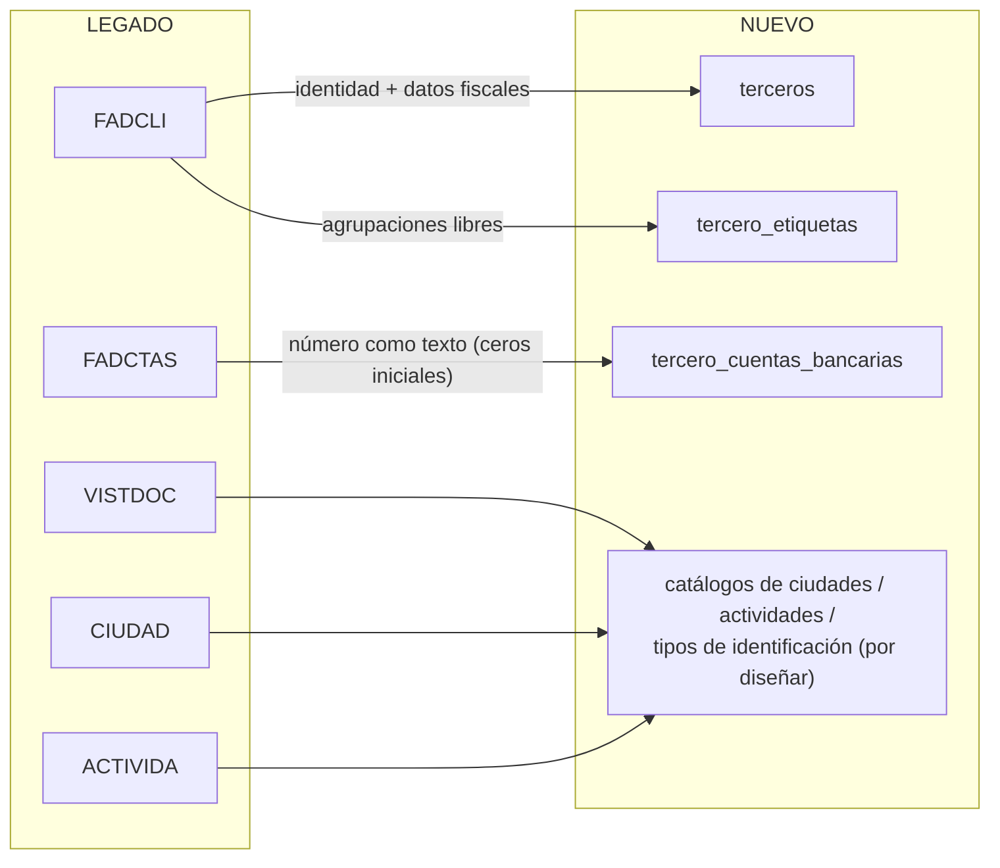

### 3.4 Fiscal: retención, IVA y exógena

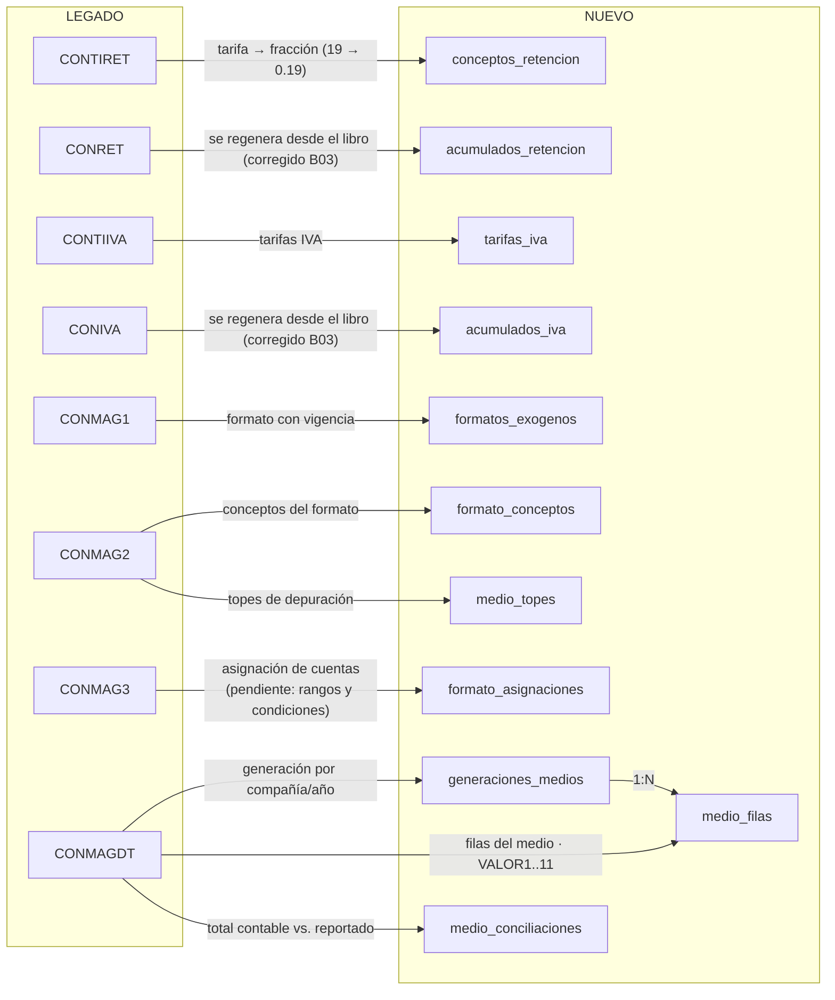

**Clave (B03):** cada renglón del libro guarda su **concepto/tarifa histórica**; los acumulados fiscales se regeneran desde el libro (original + reversión = efecto neto) y nunca se infiere la tarifa vigente para historia.

### 3.5 Activos fijos, amortizables y reembolsos

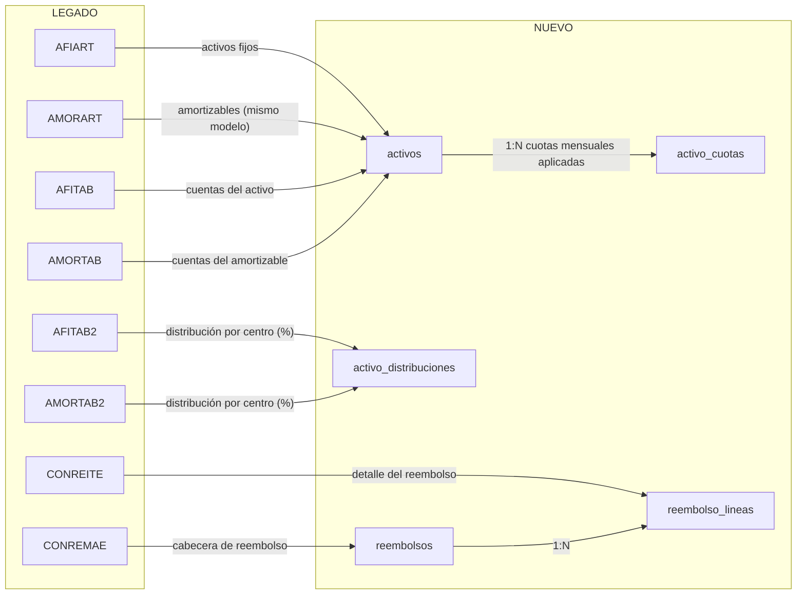

**Nota:** en el legado estas entidades **no tenían destino equivalente** (B10) y se crearon en el esquema nuevo. La estructura física de `CONREMAE/CONREITE` aún está por verificar antes de fijar la carga.

### 3.6 Consolidación, presupuesto y seguridad

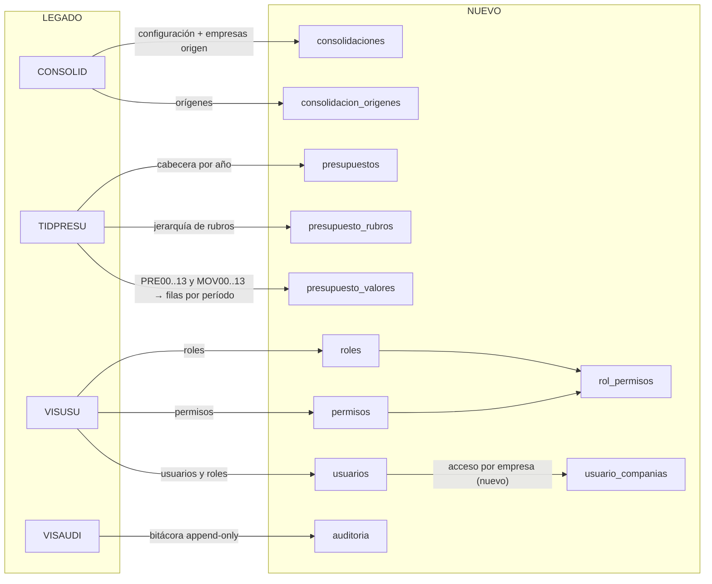

**Clave:** el legado **no tenía acceso por compañía ni permisos reales** (la función `PERMI` devolvía verdadero): el modelo nuevo se crea desde cero. El presupuesto pasa de **12+2 columnas mensuales** a filas por período y tipo.

### 3.7 Resumen: de 98 familias a 60 entidades

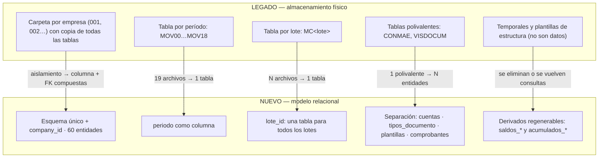

**No se migra como tabla:** `CONINTER`, `INFORMES`, `POSINFOR` (sustitución técnica), índices `.ADI`, temporales por usuario y 167 familias sin uso funcional (exclusiones con motivo en `db/old_db/EXCLUSIONES_CONTABDSI.md`).

---

## 4 · La migración de datos: cómo se pasa la información

### 4.1 La tubería

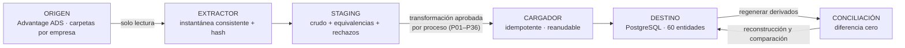

### 4.2 Fases

| Fase | Qué se hace | Sale cuando… |
|---|---|---|
| 0 · Alcance | Empresas/años, módulos activos, historia requerida, ventana | Inventario firmado |
| 1 · Perfilado | Solo lectura: tamaños, claves repetidas, huérfanos, fechas, signos | Informe por fuente + excepciones |
| 2 · Homologación | Campo → destino → transformación → prueba (2.663 campos) | Nada funcional sin destino aprobado |
| 3 · Esquema y servicios | B01–B15 (ya corregidos), migraciones versionadas | Instalable y actualizable |
| 4 · Ensayo del motor | Pruebas de lógica, integridad y concurrencia (hoy 11/11) | Pruebas críticas pasan |
| 5 · Extractor + staging | Instantánea + metadatos + hash | Extracción reproducible, origen intacto |
| 6 · Carga piloto | Una compañía/año representativos | Carga idempotente + conciliación exacta |
| 7 · Validación usuarios | Mismos casos del original, opción por opción | Aceptación por proceso |
| 8 · Ensayo general | Todas las empresas/años + restauración | Tiempos y restauración OK |
| 9 · Corte | Congelamiento → carga final → conciliación | Acta GO · un solo escritor |
| 10 · Estabilización | Legado en consulta, conciliación operativa | Aceptación final |

### 4.3 Orden de carga

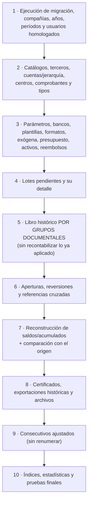

### 4.4 Las reglas que no se negocian

- **No recontabilizar**: un lote aplicado y su movimiento publicado no son dos asientos; el cargador histórico valida invariantes y conserva procedencia.
- `CONDOCUM` se concilia con `MOVxx` **antes** de reconstruir cabeceras; los huérfanos se registran como excepción.
- **No perder períodos 00 y 13–18**; apertura con una sola fuente (MOV00 **o** saldo inicial, nunca ambas).
- Códigos/NIT/números de banco **siguen como texto**; fechas inválidas a cuarentena, no a "hoy"; codificación OEM/ANSI validada por fuente.
- `RECNO` no es identidad: solo localizador dentro de una instantánea.
- Los acumulados originales se guardan como **instantánea de conciliación**; los nuevos se recalculan desde el libro aprobado.
- Cada fila deja rastro: ejecución, archivo, hash, **equivalencia de clave** y rechazo con motivo. Cargador idempotente y reanudable.
- **Migrar también los archivos** (certificados/portal `XADPDF`) con manifiesto y hash: una ruta Windows no es el documento.

### 4.5 Conciliación: el éxito es diferencia cero

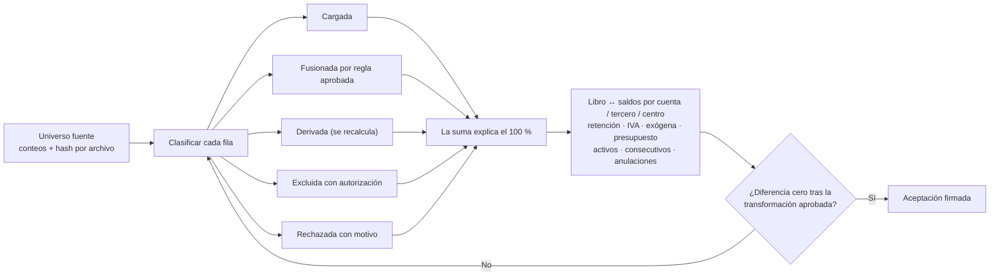

> No basta que total débito = total crédito: un error simétrico también cuadra. Se comparan **mayor, auxiliares y acumulados** con los mismos filtros del origen, además de las pruebas T01–T18 y una prueba por proceso (P01–P36).

### 4.6 Corte y reversión

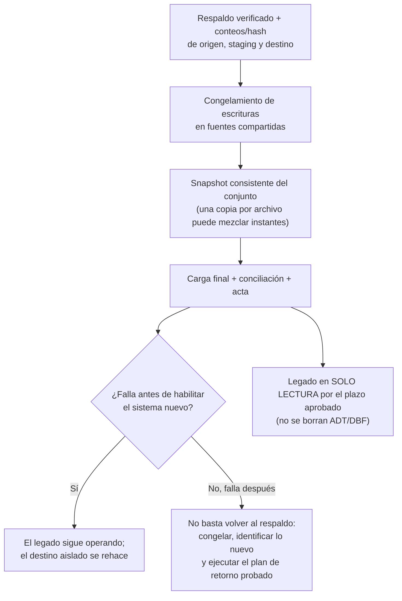

### 4.7 Estado: NO-GO — qué falta para el GO

| ✅ Ya listo en el esquema | ⏳ Falta para autorizar producción |
|---|---|
| B01–B15 corregidos · 11/11 pruebas del flujo | **Homologación campo a campo completa** (2.663 campos: 406 candidatos, 2.257 pendientes) |
| Libro multi-documento, anulación con reversión de saldos | Reglas CONMAG3 (rangos/condiciones) y detalle CONMAGIT (exógena) |
| Acumulados fiscales regenerables (B03) | Definiciones CONINF1 y selecciones por usuario (informes) |
| Aislamiento por compañía, períodos, idempotencia | Algoritmos de cierre anual, traslados 13–18 y consolidación |
| Entidades de activos, reembolsos y bancos | Repositorio de archivos/certificados (XADPDF) |
| Seguridad: roles, permisos, `usuario_companias` | Autenticación/RLS reales y bitácora inmutable en producción |
| | Regla de `modo_retencion` (el legado no persiste MCR) |
| | **Migrador versionado** (lo actual es un bootstrap de demo con `dropdb`) |

**Siguiente paso:** cerrar la homologación y probar en un entorno aislado con datos reales de una compañía/año — **no** cargar producción.

---

### Fuentes para profundizar (`db/old_db/`)

`PLAN_MIGRACION_POSTGRESQL.md` (dictamen B01–B15, fases, GO/NO-GO) · `MATRIZ_TABLAS_Y_BRECHAS.md` (98 tablas → destino, evidencia y campos) · `HOMOLOGACION_CAMPOS.md` (2.663 campos) · `MATRIZ_PROCESOS_Y_OPCIONES.md` (P01–P36 y 161 opciones) · `ESQUEMA_DEPURADO_CONTABDSI.md` / `DICCIONARIO_DEPURADO_CONTABDSI.md` (estructuras del legado) · `EXCLUSIONES_CONTABDSI.md` · `VALIDACION_HALLAZGOS.md` (dictamen de correcciones) · modelo nuevo en `db/general/` y `db/postgresql/`.
