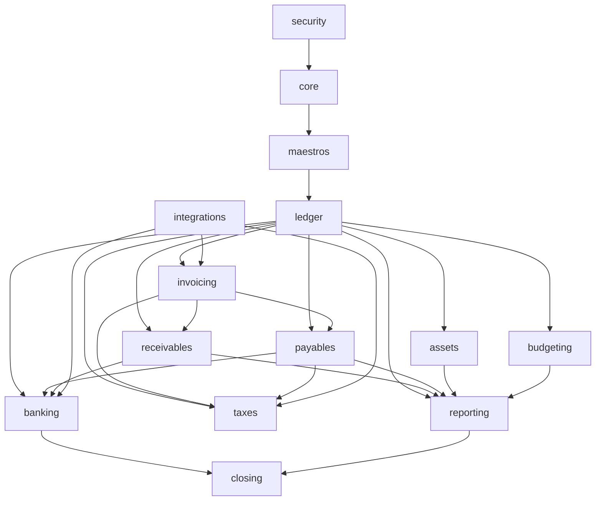

# 02 — Arquitectura de la suite

## 1. Decisión

La suite es un **monolito modular**: un repositorio, un backend desplegable, un
frontend, una base PostgreSQL y módulos internos con límites explícitos.

No se adoptan microservicios, event sourcing ni un repositorio por función. Los
motivos y las alternativas descartadas están en `10-adr.md` (ADR-001).

## 2. Estado actual y destino

| Hoy | Destino |
|---|---|
| `backend/app.py` con ~4.832 líneas y 195 rutas | Routers por módulo, servicios y repositorios |
| 60+ repositorios planos | Repositorios agrupados por módulo |
| Frontend con navegación por estado | Features por módulo + router |
| Dos motores (`ads`/`postgres`) en el mismo backend | PostgreSQL canónico; ADS como adaptador legado de lectura |
| Documentación funcional desfasada en impuestos/reembolsos | Documentación generada por módulo y actualizada en cada fase |

La migración del backend se hace **sin cambiar URLs** para no romper la interfaz
actual. Detalle en `07-roadmap.md`, fase 0.

## 3. Módulos y responsabilidades

| Módulo | Responsabilidad | Entidades principales |
|---|---|---|
| `core` | Compañías, años, periodos, monedas, tasas, secuencias, bloqueos, outbox | `compania`, `periodo`, `moneda`, `tasa_cambio`, `secuencia`, `bloqueo` |
| `maestros` | PUC, terceros, centros, diarios, tipos de documento, condiciones de pago | `cuenta`, `tercero`, `centro`, `diario`, `tipo_documento` |
| `ledger` | Asientos, lotes, contabilización, reversión, mayor, auxiliares | `asiento`, `asiento_linea`, `lote`, `lote_linea` |
| `invoicing` | Facturas de venta/compra, notas crédito/débito, DIAN | `documento`, `documento_linea`, `documento_impuesto`, `dian_documento` |
| `receivables` | CxC, recibos, aplicación de pagos, aging, cobro | `cxc`, `recibo`, `aplicacion_pago`, `gestion_cobro` |
| `payables` | CxP, propuestas de pago, retenciones, anticipos, gastos | `cxp`, `pago`, `propuesta_pago`, `retencion` |
| `banking` | Cuentas, extractos, conciliación, transferencias, cheques, caja | `cuenta_bancaria`, `extracto`, `extracto_linea`, `conciliacion` |
| `assets` | Activos, categorías, depreciación, bajas, revalorización | `activo`, `categoria`, `depreciacion`, `baja` |
| `budgeting` | Versiones, líneas, control, ejecución | `presupuesto`, `presupuesto_linea`, `control` |
| `taxes` | Impuestos, posiciones fiscales, retenciones, exógena, medios | `impuesto`, `posicion_fiscal`, `concepto_retencion`, `exogena_*`, `media_*` |
| `reporting` | Estados financieros, libros, NIIF, comparativos, snapshots | `reporte`, `reporte_ejecucion`, `snapshot_linea` |
| `closing` | Cierres, apertura, consolidación, eliminaciones | `cierre`, `cierre_linea`, `consolidacion`, `eliminacion` |
| `security` | Usuarios, roles, permisos, auditoría inmutable | `usuario`, `rol`, `permiso`, `auditoria` |
| `integrations` | DIAN, bancos, e-commerce/CRM, IA, API keys, webhooks | `conector`, `ejecucion`, `webhook`, `outbox` |

## 4. Dependencias entre módulos



Reglas:

1. Las flechas indican dependencia de **servicio**, no acceso a tablas.
2. Ningún módulo lee o escribe tablas de otro; usa el servicio público del otro.
3. `core` y `maestros` son el núcleo compartido; no dependen de módulos de negocio.
4. `ledger` no conoce facturas, bancos ni activos: recibe comandos de
   contabilización.
5. `reporting` es de solo lectura; nunca escribe en el libro.
6. `closing` orquesta; no calcula impuestos ni depreciaciones por su cuenta.

## 5. Estructura interna de un módulo

```text
modules/<modulo>/
  api/            # routers FastAPI, validación de entrada/salida
  service/        # casos de uso y reglas de negocio
  domain/         # entidades, value objects, invariantes
  repository/     # SQL/ORM del módulo (dueño de sus tablas)
  events/         # eventos publicados y consumidores
  schemas/        # Pydantic de entrada/salida
  tests/          # unitarios e integración
```

Regla de dependencia interna: `api → service → domain`; `service → repository`;
`repository → PostgreSQL`. Nunca al revés.

## 6. API

### 6.1 Convenciones

- Prefijo versionado: `/api/v1/<modulo>/...`.
- Compatibilidad: las rutas actuales `/api/...` se mantienen como alias hasta el
  corte; se documenta su equivalencia.
- Comandos con `POST/PUT/PATCH/DELETE`; consultas con `GET`.
- Contexto de compañía obligatorio: `compania_id` en el token o en el path,
  validado contra los permisos del usuario.
- Paginación por cursor o `limit/offset` con máximo configurable.
- Errores uniformes (`type`, `title`, `status`, `detail`, `instance`), sin
  filtrar trazas internas.
- `Idempotency-Key` obligatorio en comandos que crean documentos o pagos.
- `If-Match`/`version` para concurrencia optimista en maestros.
- Operaciones destructivas o masivas: `dryRun` + `motivo` obligatorio.
- Fechas ISO 8601, importes como string decimal o número con escala fija.

### 6.2 Ejemplo de contrato

```text
POST /api/v1/invoicing/invoices
Idempotency-Key: 7f2c...
{
  "compania_id": 1,
  "tipo": "FV",
  "tercero_id": 123,
  "fecha": "2026-10-21",
  "moneda": "COP",
  "condicion_pago_id": 2,
  "lineas": [
    {"cuenta_id": 240, "descripcion": "Servicio", "cantidad": 1,
     "precio_unitario": "1000000.00", "impuesto_id": 1,
     "centro_id": 4}
  ]
}
→ 201 {"documento_id": 9001, "numero": "FV-000123", "estado": "borrador"}
```

## 7. Transacciones

1. **Un comando = una transacción.** Factura + asiento + CxC + impuestos se
   confirman juntos o no se confirma nada.
2. **Servicio único de contabilización.** `ledger.post(comando)` valida, reserva
   secuencia, inserta asiento/líneas, actualiza partidas abiertas y publica
   eventos.
3. **Bloqueos:**
   - Secuencia: `SELECT ... FOR UPDATE` sobre la fila de secuencia.
   - Partida abierta: `FOR UPDATE` al aplicar pagos.
   - Periodo: validación y bloqueo lógico; nunca se contabiliza en periodo
     cerrado.
4. **Aislamiento:** `READ COMMITTED` por defecto; `SERIALIZABLE` solo donde se
   detecte contención real.
5. **Sin escrituras fuera de transacción.** Los eventos se guardan en la misma
   transacción (outbox) y un worker los publica después.
6. **Reintentos:** los comandos idempotentes pueden reintentarse; los workers
   usan backoff y deduplicación por clave.

## 8. Eventos

| Evento | Origen | Consumidores |
|---|---|---|
| `documento.contabilizado` | `invoicing` | `receivables`, `payables`, `taxes`, `reporting` |
| `pago.aplicado` | `receivables`/`payables` | `ledger`, `banking`, `reporting` |
| `extracto.conciliado` | `banking` | `ledger`, `receivables`, `payables` |
| `activo.depreciado` | `assets` | `ledger`, `reporting` |
| `periodo.cerrado` | `closing` | `ledger`, `taxes`, `reporting`, `budgeting` |
| `dian.documento.recibido` | `integrations` | `invoicing`, `taxes` |
| `presupuesto.aprobado` | `budgeting` | `reporting` |

Los eventos son **notificaciones internas**, no la fuente de verdad. La verdad
está en las tablas; el evento permite efectos asíncronos (XML DIAN, correo,
snapshot) sin acoplar módulos.

## 9. Seguridad

1. Autenticación por sesión/token; contraseñas fuera del modelo contable.
2. RBAC: rol → permisos por módulo/acción; alcance por compañía.
3. Segregación de funciones: quien crea una factura no la aprueba/paga si el
   rol no lo permite; quien cierra un periodo no lo reabre sin autorización.
4. Row-level security opcional por `compania_id`; el servicio también valida.
5. Secretos en variables de entorno o gestor de secretos; nunca en el repo.
6. Auditoría append-only con actor, request ID, antes/después y motivo.
7. Cifrado en tránsito (TLS) y respaldo cifrado.
8. Límite de intentos y bloqueo de sesión; expiración configurable.

## 10. Despliegue

```text
[Caddy/TLS] → [FastAPI app] → [PostgreSQL]
                    ↓
              [worker]  → DIAN / bancos / correo
                    ↓
              [scheduler] → depreciaciones, cierres, recordatorios
```

- Un contenedor de aplicación (React compilado + API + Caddy) y un worker
  opcional para tareas asíncronas.
- PostgreSQL 18 con backups automáticos y pruebas de restauración.
- Ambientes: desarrollo, pruebas, producción; datos anonimizados fuera de
  producción.
- Migraciones versionadas y ejecutadas en el despliegue; nunca manuales.

## 11. Observabilidad

- Logs estructurados con `request_id`, `compania_id`, `usuario_id`, módulo y
  operación.
- Métricas: latencia, errores, posteos/minuto, conciliaciones pendientes,
  trabajos DIAN, tamaño de colas.
- Trazas para comandos críticos (posteo, pago, cierre).
- Alertas: fallos de DIAN, diferencias de conciliación, periodos sin cerrar,
  backups fallidos.

## 12. Refactor de la base actual

Orden mínimo antes de agregar módulos nuevos:

1. Extraer routers de `backend/app.py` por dominio, conservando URLs.
2. Mover lógica de negocio a `service/`; dejar los routers delgados.
3. Agrupar repositorios por módulo y eliminar duplicación.
4. Introducir `core` (compañía, periodo, secuencia, auditoría) como dependencia
   compartida.
5. Pasar el frontend a `features/<modulo>/` con un router explícito.
6. Congelar el esquema actual y crear migraciones para las tablas nuevas.
7. Añadir CI con pruebas y migraciones reversibles.

## 13. No objetivos

- Microservicios por módulo.
- Event sourcing como mecanismo principal.
- Multitenencia SaaS.
- Reescritura total del frontend en una sola fase.
- Dependencia de Odoo en tiempo de ejecución.

## 14. Reglas de oro

1. Sin tabla compartida sin dueño.
2. Sin asiento fuera del servicio de contabilización.
3. Sin edición de documentos contabilizados.
4. Sin saldo sin trazabilidad al libro.
5. Sin doble escritura entre PostgreSQL y Advantage.
6. Sin operación sin auditoría.
7. Sin cambio de esquema sin migración y prueba de reversión.
