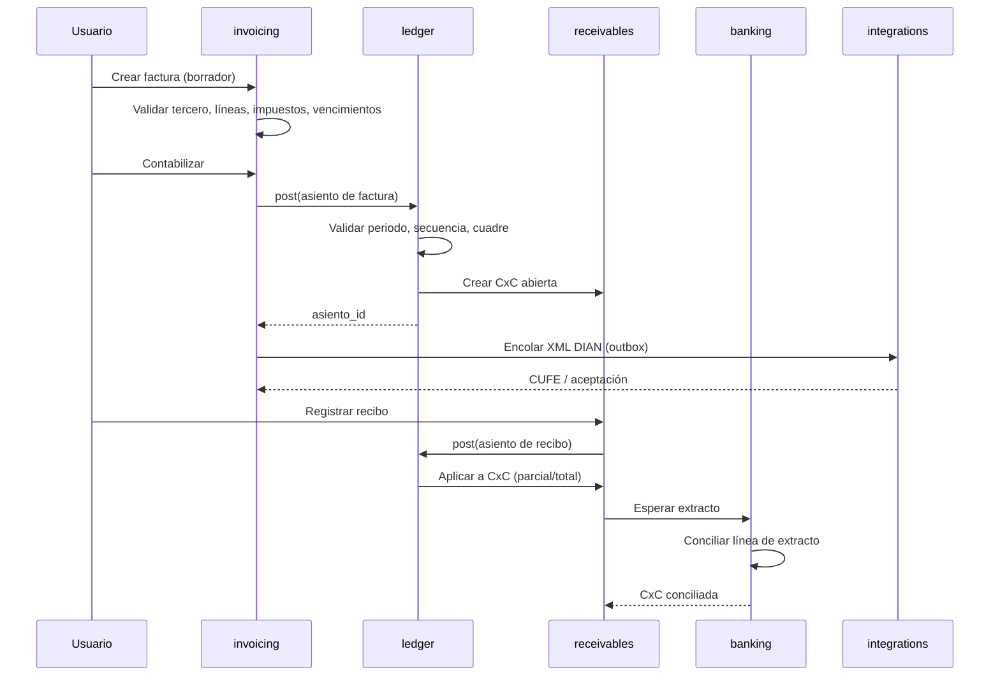
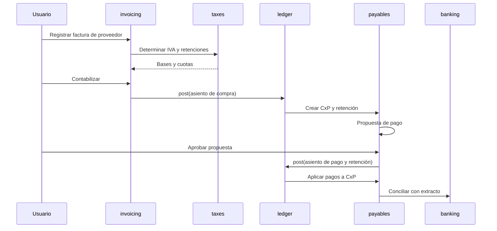

# 04 — Flujo definitivo del dato

Este documento fija **cómo viaja el dato** desde que se crea un documento hasta
que aparece en un informe, un pago, una declaración o un cierre. Es la referencia
vinculante para todos los módulos.

## 1. Reglas canónicas

| ID | Regla |
|---|---|
| R-01 | PostgreSQL es el almacén canónico de la suite. Advantage es solo fuente legada de lectura durante la transición |
| R-02 | El libro contable es la fuente de verdad de saldos, impuestos, cartera, CxP y presupuesto ejecutado |
| R-03 | Todo asiento se crea por el servicio `ledger.post`; ningún módulo inserta en `led.asiento` por su cuenta |
| R-04 | Un comando de negocio se ejecuta en una sola transacción |
| R-05 | Todo comando que crea documentos, pagos o asientos exige `Idempotency-Key` |
| R-06 | La secuencia se reserva dentro de la misma transacción del posteo |
| R-07 | Un documento contabilizado es inmutable; se corrige por reversión |
| R-08 | No se contabiliza en periodo cerrado ni después de un bloqueo |
| R-09 | Toda entidad transaccional pertenece a una compañía; no hay asientos cruzados salvo intercompañía explícita |
| R-10 | Se guardan importes en moneda del documento y en moneda funcional |
| R-11 | El impuesto se determina por línea; nunca se reparte un total a mano |
| R-12 | Las partidas abiertas nacen del posteo; los pagos solo se aplican, no editan saldos |
| R-13 | La conciliación bancaria enlaza líneas; los ajustes se contabilizan como asientos nuevos |
| R-14 | Los activos fijos generan sus asientos por el mismo servicio de contabilización |
| R-15 | El presupuesto ejecutado se lee del libro; los compromisos se registran al validar el documento |
| R-16 | Los informes leen datos contabilizados o snapshots certificados |
| R-17 | Toda escritura deja auditoría con actor, fecha, motivo y request ID |
| R-18 | Los efectos asíncronos usan outbox transaccional y worker con reintentos |
| R-19 | Prohibida la doble escritura PostgreSQL–Advantage |
| R-20 | Un error en cualquier paso revierte toda la operación; no hay estados intermedios |

## 2. Pipeline de contabilización

Todo documento sigue el mismo pipeline:

```text
1. Idempotencia
2. Autorización y compañía
3. Validación de fecha, periodo y bloqueo
4. Validación de maestros (cuenta, tercero, centro, diario, tipo)
5. Determinación de impuestos y retenciones por línea
6. Cálculo de bases, cuotas y redondeos
7. Validación de cuadre y naturaleza
8. Reserva de secuencia
9. Inserción del asiento y líneas (estado contabilizado)
10. Efectos: CxC/CxP, vencimientos, presupuesto, referencias
11. Auditoría + outbox
12. Commit
13. Efectos asíncronos: DIAN, notificaciones, materialización
```

### 2.1 Algoritmo `ledger.post`

```text
entrada: comando {compania, tipo, fecha, diario, moneda, tasa, lineas, origen,
                  idempotency_key, usuario, motivo}
1. si existe asiento con idempotency_key → devolverlo
2. validar permisos y compañía
3. cargar periodo y verificar estado abierto y bloqueos
4. cargar maestros y verificar pertenencia a la compañía
5. para cada línea: determinar impuesto/retención, base, cuota y cuenta
6. redondear por línea y calcular totales del documento
7. verificar débitos = créditos y una sola naturaleza por línea
8. bloquear secuencia (SELECT FOR UPDATE) y reservar número
9. insertar asiento y líneas
10. crear/actualizar partidas abiertas y vencimientos
11. registrar compromiso/ejecución presupuestal si aplica
12. insertar auditoría y eventos en outbox
13. commit
14. devolver asiento
```

Si falla cualquier paso, no se reserva número y no queda nada escrito.

## 3. Flujo 1: factura de venta → cartera → pago → banco



### 3.1 Pasos y efectos

1. **Borrador:** se validan tercero, líneas, producto/servicio, impuestos y
   condición de pago. No hay efectos contables.
2. **Contabilización:** se calcula base/IVA/retenciones, se cuadra y se postea.
   Se crea la CxC con sus vencimientos y se reserva el número.
3. **DIAN:** se genera el XML UBL 2.1, se firma (proveedor), se envía y se guarda
   CUFE/estado. Un rechazo no borra la factura: se corrige con nota o se reenvía.
4. **Recibo:** se registra el pago (efectivo, banco, transferencia). Se postea el
   asiento y se aplica a una o varias CxC.
5. **Conciliación:** el extracto bancario enlaza el recibo con el movimiento
   bancario. Si el banco cobra comisión, se crea un asiento de gasto.
6. **Cartera:** el saldo es la suma de partidas abiertas. Aging, estado de cuenta
   y cobro se calculan desde esas partidas.

## 4. Flujo 2: factura de compra → CxP → retención → pago



Reglas:

- La retención se causa en el documento o en el pago según el concepto; queda
  registrada con certificado y cuenta de pasivo.
- El pago neto = total factura − retenciones − anticipos aplicados.
- Una propuesta de pago selecciona CxP por vencimiento, tercero y prioridad; su
  aprobación es un acto auditado y segregado del usuario que la creó.
- El pago puede ser parcial; la CxP queda `parcial` hasta completarse.

## 5. Flujo 3: extracto bancario y conciliación

```text
1. Importar extracto (CSV/XLSX/OFX) o capturarlo manualmente
2. Validar hash de archivo y duplicados
3. Verificar saldo inicial + movimientos = saldo final
4. Registrar líneas del extracto (estado pendiente)
5. Aplicar reglas de matching:
   a. referencia + importe exacto
   b. importe + fecha ± tolerancia
   c. tercero/NIT en descripción
   d. coincidencia difusa con candidatos
6. Matching manual para lo no resuelto
7. Si hay diferencia: crear asiento de comisión/interés/diferencia
8. Marcar línea y asiento como conciliados
9. Generar reporte de partidas conciliatorias
```

Reglas:

- La conciliación **no modifica** la línea del libro; crea una relación.
- Una línea de extracto puede conciliarse con varias líneas del libro y
  viceversa, siempre que la suma cuadre.
- Las diferencias no explicadas quedan como partidas conciliatorias, nunca se
  “ajustan” contra el saldo.
- El extracto conciliado se bloquea; una corrección exige reabrir con auditoría.

## 6. Flujo 4: activo fijo y depreciación

```text
1. Alta del activo (desde factura de compra o manual)
2. Asignar categoría, vida útil, método, valor residual, centro y cuentas
3. Generar tabla de depreciación (una cuota por periodo)
4. Job mensual:
   a. verificar periodo abierto
   b. calcular cuota del periodo
   c. postear asiento: gasto / depreciación acumulada
   d. guardar cuota con asiento_id
   e. actualizar estado (activo → totalmente depreciado)
5. Baja:
   a. calcular valor en libros
   b. postear venta/baja y resultado
   c. cerrar cuotas futuras
6. Revalorización/deterioro: postear ajuste y recalcular cuotas futuras
```

Reglas:

- La suma de cuotas nunca supera costo − valor residual.
- No se deprecia dos veces el mismo activo/periodo.
- La depreciación fiscal puede diferir de la contable; se guardan ambas y se
  concilian en el informe.
- La baja no borra el activo: cambia estado y conserva historia.

## 7. Flujo 5: presupuesto y control

```text
1. Crear versión de presupuesto (borrador)
2. Cargar líneas por cuenta, centro y periodo
3. Aprobar versión (inmutable)
4. Al validar factura/compra: registrar compromiso
5. Al contabilizar: convertir compromiso en ejecución
6. Control antes del posteo:
   disponible = presupuesto − ejecutado − comprometido
   si disponible < importe y modo = bloquear → rechazar
   si modo = avisar → permitir con aprobación y auditoría
7. Reporte presupuesto vs. real vs. compromiso
```

Reglas:

- El presupuesto aprobado no se edita; se crea una versión nueva.
- La ejecución se calcula del libro por cuenta/centro/periodo; no se digita.
- Los compromisos se liberan al reversar o anular el documento.

## 8. Flujo 6: impuestos, exógena y medios

```text
1. Determinación por línea (IVA, retención, ICA)
2. Posteo con cuentas de impuesto
3. Acumulados del periodo desde el libro (no editables)
4. Reporte de impuestos y conciliación con documentos
5. Declaración: se genera el borrador y se exporta; no se presenta
6. Exógena:
   a. seleccionar formato y año
   b. generar filas por concepto/tercero
   c. validar 5 valores (base, valor, retención, etc.)
   d. revisar diferencias contra el libro
   e. exportar XML/CSV/XLSX y marcar como exportado
7. Medios magnéticos: mismo flujo con topes y cuadre
```

Reglas:

- Los acumulados fiscales se derivan del libro; si se materializan, se pueden
  reconstruir y nunca se editan a mano.
- Una generación exportada es inmutable; una corrección exige una generación
  nueva con motivo.
- La validación de 5 valores debe dar cero diferencias para exportar.
- La presentación ante la DIAN queda fuera del sistema; se integra o se hace en
  el portal.

## 9. Flujo 7: cierre mensual

```text
1. Abrir checklist del periodo
2. Verificar:
   - facturas y notas contabilizadas
   - lotes pendientes
   - extractos conciliados
   - depreciaciones del mes
   - retenciones y IVA causados
   - diferencias de cambio
   - provisiones y ajustes
3. Postear asientos de ajuste
4. Calcular resultado del periodo
5. Postear cierre (resultado → patrimonio)
6. Cerrar y bloquear el periodo
7. Generar saldos de apertura del siguiente
8. Snapshot de estados financieros
9. Registrar acta/checklist firmado
```

Reglas:

- No se cierra con partidas conciliatorias sin explicar.
- El cierre es idempotente: repetirlo no duplica asientos.
- Reabrir exige permiso especial, motivo y auditoría; el snapshot anterior se
  conserva.

## 10. Flujo 8: consolidación

```text
1. Configurar compañía destino y orígenes
2. Homologar cuentas y centros origen → destino
3. Simular: agregar saldos contabilizados
4. Identificar operaciones intercompañía
5. Generar eliminaciones (ventas/compras, CxC/CxP, préstamos)
6. Cuadrar eliminaciones
7. Ejecutar consolidación
8. Generar estados consolidados y snapshot
```

Reglas:

- Solo se consolidan asientos contabilizados.
- La consolidación no mezcla libros: crea un libro consolidado separado.
- Las eliminaciones son asientos explícitos y auditables.
- Si un origen no está cerrado, la consolidación queda en simulación.

## 11. Flujo 9: reversión

```text
1. Seleccionar documento contabilizado
2. Exigir motivo (5–500 caracteres)
3. Verificar periodo abierto (o permiso de reversión extemporánea)
4. Crear asiento espejo con referencia al original
5. Reabrir/ajustar partidas abiertas y compromisos
6. Marcar original como revertido
7. Auditar y notificar
```

Nunca se borra el original. Una factura revertida conserva su número y su XML
DIAN; la nota crédito es el documento fiscal de corrección cuando aplica.

## 12. Flujo 10: informes y snapshots

```text
1. Usuario elige reporte y parámetros
2. Validar permisos y compañía
3. Ejecutar consulta sobre datos contabilizados
4. Aplicar reglas de presentación y comparativos
5. Devolver resultado paginado o exportar
6. Si el informe es certificable: congelar snapshot + hash + firma
```

Reglas:

- Un informe operativo se puede recalcular.
- Un informe certificado se conserva con sus líneas y hash; no cambia si el
  libro cambia después.
- Los informes nunca leen borradores, salvo los de control interno.

## 13. Matriz de eventos

| Evento | Emisor | Consumidores | Efecto |
|---|---|---|---|
| `documento.validado` | `invoicing` | `budgeting` | Registra compromiso |
| `documento.contabilizado` | `ledger` | `ar`, `ap`, `taxes`, `reporting` | Partida abierta, impuestos |
| `documento.revertido` | `ledger` | `ar`, `ap`, `budgeting` | Reabre/libera |
| `pago.registrado` | `ar`/`ap` | `ledger` | Asiento de pago |
| `pago.aplicado` | `ar`/`ap` | `ledger`, `reporting` | Actualiza saldo |
| `extracto.conciliado` | `banking` | `ar`, `ap`, `ledger` | Enlaces y ajustes |
| `activo.depreciado` | `assets` | `ledger`, `reporting` | Asiento mensual |
| `periodo.cerrado` | `closing` | `ledger`, `taxes`, `reporting` | Bloqueo y snapshot |
| `presupuesto.aprobado` | `budgeting` | `reporting` | Base de control |
| `dian.aceptado` | `integrations` | `invoicing` | Estado fiscal |
| `dian.rechazado` | `integrations` | `invoicing`, `taxes` | Corrección/contingencia |

### 13.1 Matriz comando → tablas → evento

| Comando | Tablas que escribe | Evento |
|---|---|---|
| Crear factura (borrador) | `inv.documento`, `inv.documento_linea`, `inv.documento_impuesto` | — |
| Contabilizar factura | `led.asiento`, `led.asiento_linea`, `inv.documento`, `ar.cxc` o `ap.cxp`, `inv.documento_vencimiento` | `documento.contabilizado` |
| Revertir factura | `led.asiento` (nuevo), `inv.documento`, `ar.cxc`/`ap.cxp` | `documento.revertido` |
| Registrar recibo/pago | `ar.recibo`/`ap.pago`, `led.asiento`, `ar.aplicacion_pago`/`ap.aplicacion_pago` | `pago.registrado` |
| Aplicar pago | `ar.aplicacion_pago`/`ap.aplicacion_pago`, `ar.cxc`/`ap.cxp` | `pago.aplicado` |
| Importar extracto | `bnk.extracto`, `bnk.extracto_linea` | — |
| Conciliar | `bnk.conciliacion`, `led.asiento_linea`, ajuste en `led.asiento` si hay diferencia | `extracto.conciliado` |
| Generar depreciación | `ast.depreciacion`, `led.asiento`, `led.asiento_linea` | `activo.depreciado` |
| Dar de baja activo | `ast.baja`, `led.asiento`, `ast.activo` | `activo.dado_de_baja` |
| Aprobar presupuesto | `bgt.presupuesto`, `bgt.linea` | `presupuesto.aprobado` |
| Registrar compromiso | `bgt.compromiso` | `compromiso.registrado` |
| Generar exógena | `tax.exogena_generacion`, `tax.exogena_fila`, `tax.exogena_conciliacion` | — |
| Enviar DIAN | `inv.dian_documento`, `intg.ejecucion` | `dian.enviado` |
| Cerrar periodo | `cls.cierre`, `cls.cierre_linea`, `core.periodo`, `led.asiento` | `periodo.cerrado` |
| Consolidar | `cls.consolidacion`, `cls.eliminacion`, `led.asiento` (libro consolidado) | `consolidacion.ejecutada` |
| Certificar informe | `rpt.ejecucion`, `rpt.snapshot`, `rpt.snapshot_linea` | `snapshot.certificado` |

Regla: ninguna tabla se escribe fuera de su módulo dueño. Los efectos cruzados se
producen por el servicio del módulo dueño o por un consumidor de evento
idempotente.

## 14. Concurrencia e idempotencia

1. Secuencias con bloqueo de fila; nunca `MAX(numero)+1`.
2. Partidas abiertas bloqueadas al aplicar pagos, en orden de `id` para evitar
   interbloqueos.
3. Comandos idempotentes por clave única; el reintento devuelve el resultado
   original.
4. Workers con deduplicación por evento y reintentos con backoff.
5. Si un efecto asíncrono falla, el documento contable ya está confirmado; el
   outbox garantiza la reintento y la alerta.
6. No se usan transacciones distribuidas: los efectos externos son eventuales.

## 15. Ejemplo completo con números

**Factura de venta**

- Base: 1.000.000,00
- IVA 19 %: 190.000,00
- Total: 1.190.000,00

Asiento:

| Cuenta | Débito | Crédito |
|---|---:|---:|
| CxC cliente | 1.190.000,00 | |
| Ingreso por servicio | | 1.000.000,00 |
| IVA por pagar | | 190.000,00 |

**Recibo**

- Pago: 1.190.000,00 por banco.

| Cuenta | Débito | Crédito |
|---|---:|---:|
| Banco | 1.190.000,00 | |
| CxC cliente | | 1.190.000,00 |

**Efectos**

- CxC: abierta 1.190.000 → pagada 0.
- Extracto: línea de 1.190.000 conciliada con el recibo.
- IVA: acumulado del periodo 190.000.
- Estado de resultados: ingreso 1.000.000.
- Cierre: IVA por pagar 190.000; resultado 1.000.000 al patrimonio.
- DIAN: XML con CUFE y total 1.190.000.

**Compra con retención (ejemplo ilustrativo)**

- Base: 1.000.000,00; IVA 19 %: 190.000,00; retención: 100.000,00.
- Neto a pagar: 1.090.000,00.

| Cuenta | Débito | Crédito |
|---|---:|---:|
| Gasto | 1.000.000,00 | |
| IVA descontable | 190.000,00 | |
| Retención por pagar | | 100.000,00 |
| CxP proveedor | | 1.090.000,00 |

El pago cancela la CxP por 1.090.000 y la retención se declara/exporta por
100.000. Las tarifas y bases reales se parametrizan; este ejemplo no fija
porcentajes legales.
