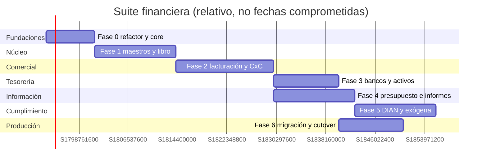

# 07 — Roadmap, fases y backlog

## 1. Enfoque

El roadmap se organiza por **fases con criterios de salida**, no por fechas
prometidas. Cada fase entrega un módulo o un grupo de módulos certificable y deja
el sistema en un estado desplegable. El alcance detallado de cada fase son las
**159 funciones** de `01-catalogo-funcional.md`; el backlog de la sección 4 las
agrupa en épicas. Las fases pueden solaparse en el tiempo si
los equipos son distintos, pero **no se puede iniciar una fase que dependa de
entidades no cerradas en la anterior**.

Unidad de esfuerzo: **sprint de 2 semanas** con un equipo de referencia de:

- 1 arquitecto/tech lead.
- 2–3 backend.
- 1–2 frontend.
- 1 QA.
- Contador/revisor fiscal como validador funcional (tiempo parcial).
- 1 líder de producto/negocio (tiempo parcial).

El esfuerzo indicado es relativo (`S`, `M`, `L`, `XL`) y debe recalibrarse al
cerrar cada fase.

## 2. Fases

### Fase 0 — Fundaciones y refactor

**Objetivo.** Preparar el terreno sin cambiar el comportamiento visible.

| Entregable | Detalle |
|---|---|
| Routers por dominio | Partir `backend/app.py` sin cambiar URLs |
| `core` mínimo | Compañía, periodo, moneda, secuencia, bloqueo, auditoría, outbox |
| Seguridad | Roles, permisos, alcance por compañía, sesión |
| Migraciones | Numeración global, reversibles, CI |
| Frontend | Estructura por features y router |
| Observabilidad | Logs, métricas, request ID |
| CI/CD | Lint, tipos, tests, migraciones, build |

**Criterios de salida.**

- La suite actual sigue funcionando con las mismas URLs.
- Existe una prueba de humo E2E verde.
- Una migración se aplica y se revierte en CI.
- El 100 % de las rutas nuevas usan `core` para compañía/periodo/auditoría.

**Esfuerzo:** L (6–10 sprints). **Depende de:** nada.

---

### Fase 1 — Núcleo contable

**Objetivo.** Libro contable definitivo, reconstruible y auditable.

| Entregable | Detalle |
|---|---|
| Maestros | PUC, terceros, centros, diarios, tipos de documento, condiciones |
| Servicio `ledger.post` | Validación, impuestos, secuencia, asiento, auditoría |
| Lotes | Borrador, validación, contabilización |
| Reversión | Asiento espejo, motivo, referencias |
| Periodos y bloqueos | Apertura/cierre, bloqueo duro |
| Consultas | Mayor, auxiliares, comprobación, asientos |
| Saldos | Derivados y materializados |

**Criterios de salida.**

- Un asiento manual y un lote producen el mismo resultado contable.
- No se postea en periodo cerrado; no hay secuencias duplicadas.
- Revertir dos veces no duplica.
- El balance de comprobación cuadra con el mayor.
- Pruebas de concurrencia en secuencias y posteo.

**Esfuerzo:** XL (10–14 sprints). **Depende de:** Fase 0.

---

### Fase 2 — Facturación, cartera y CxP

**Objetivo.** Ciclo comercial completo sin inventario.

| Entregable | Detalle |
|---|---|
| Facturación | Facturas venta/compra, notas, vencimientos |
| Impuestos por línea | IVA y retenciones básicas |
| Cartera | CxC, recibos, aplicación de pagos, aging, estado de cuenta |
| CxP | Propuestas, pagos, retenciones, anticipos |
| Integración DIAN | Contrato y adaptador (sin habilitación productiva aún) |
| Presupuesto (compromisos) | Registro al validar y liberar al revertir |

**Criterios de salida.**

- Factura con IVA genera asiento, CxC y vencimiento exactos.
- Pago parcial y total actualizan saldo y estado.
- Nota crédito reduce cartera e impuestos.
- Factura de compra con retención genera CxP neta y pasivo.
- Aging y estado de cuenta cuadran con el libro.
- Conciliación de pagos contra extracto en ambiente de prueba.

**Esfuerzo:** XL (12–16 sprints). **Depende de:** Fase 1.

---

### Fase 3 — Bancos y activos fijos

**Objetivo.** Tesorería y depreciación integradas al libro.

| Entregable | Detalle |
|---|---|
| Bancos | Cuentas, extractos, importación, conciliación, diferencias |
| Reglas | Matching automático y manual |
| Transferencias/cheques/caja | Asientos y control |
| Activos | Categorías, alta, tabla de depreciación |
| Depreciación | Job mensual idempotente, asiento, estados |
| Bajas/revalorización | Resultado y ajustes |

**Criterios de salida.**

- Extracto descuadrado se rechaza; conciliado se bloquea.
- Partidas conciliatorias explican el 100 % de la diferencia.
- La suma de depreciaciones = costo − residual.
- Dos ejecuciones del job no duplican asientos.
- Baja de activo genera resultado y cierra cuotas.

**Esfuerzo:** L (8–12 sprints). **Depende de:** Fases 1 y 2.

---

### Fase 4 — Presupuesto, informes y cierres

**Objetivo.** Planeación, información financiera y cierre formal.

| Entregable | Detalle |
|---|---|
| Presupuesto | Versiones, líneas, control, ejecución, compromisos |
| Informes | Comprobación, mayor, auxiliares, estados financieros, comparativos |
| NIIF | Mapeo PUC→rubro, ESFA, flujo de caja |
| Cierres | Checklist, asientos, bloqueo, apertura |
| Consolidación | Homologación, eliminaciones, libro consolidado |
| Snapshots | Informes certificables con hash |

**Criterios de salida.**

- Presupuesto bloqueado rechaza excesos.
- Real vs. presupuesto cuadra con el libro.
- Cierre reproducible y bloqueo efectivo.
- Apertura = cierre anterior.
- Consolidación cuadra y elimina intercompañía.
- Snapshot no cambia al postear después.

**Esfuerzo:** XL (12–16 sprints). **Depende de:** Fases 1–3.

---

### Fase 5 — Cumplimiento colombiano completo

**Objetivo.** DIAN, exógena y medios en producción.

| Entregable | Detalle |
|---|---|
| DIAN electrónica | Integración con proveedor, XML/CUFE, eventos, contingencia |
| IVA/retenciones | Declaraciones, certificados, conciliación |
| Exógena | Formatos, conceptos, mapeos, validación de 5 valores, exportación |
| Medios magnéticos | Generación, topes, cuadre, exportación |
| Calendario | Obligaciones y alertas |
| ICA | Parametrización municipal y reportes |

**Criterios de salida.**

- Factura electrónica aceptada en habilitación.
- Nota crédito electrónica aceptada y referencia correcta.
- IVA del periodo cuadra con el libro.
- Exógena sin diferencias en la validación de 5 valores.
- Medios exportados e inmutables.
- Certificados de retención emitidos.

**Esfuerzo:** XL (12–16 sprints). **Depende de:** Fases 2 y 4.

---

### Fase 6 — Migración, cutover y hardening

**Objetivo.** Pasar a producción con riesgo controlado.

| Entregable | Detalle |
|---|---|
| ETL | Extracción, staging, transformación, carga, conciliación |
| Saldos y partidas | Apertura, CxC/CxP, activos, presupuesto |
| Secuencias | Rangos y resoluciones |
| Dual-run | Lectura comparada, no doble escritura |
| Cutover | Congelamiento, corte, verificación, rollback |
| Hardening | Carga, seguridad, backups, runbooks |

**Criterios de salida.**

- Conciliación firmada por contador/revisor.
- Cero diferencias por cuenta/tercero/periodo.
- Rollback probado.
- Backups y restauración probados.
- Manuales y runbooks publicados.

**Esfuerzo:** L (8–12 sprints). **Depende de:** Fases 1–5.

## 3. Vista temporal

> Las barras son ilustrativas y se solapan por equipos. La regla vinculante son
> las dependencias y los criterios de salida, no las fechas del gráfico.

## 4. Backlog por épicas

| ID | Épica | Módulo | Fase |
|---|---|---|---|
| SF-001 | Refactor de routers y servicios | transversal | 0 |
| SF-002 | Core: compañías, periodos, monedas, secuencias | `core` | 0 |
| SF-003 | Seguridad, roles y auditoría | `security` | 0 |
| SF-004 | PUC y maestros contables | `maestros` | 1 |
| SF-005 | Servicio de contabilización | `ledger` | 1 |
| SF-006 | Lotes y captura | `ledger` | 1 |
| SF-007 | Reversión e inmutabilidad | `ledger` | 1 |
| SF-008 | Facturas de venta y compra | `invoicing` | 2 |
| SF-009 | Notas crédito/débito | `invoicing` | 2 |
| SF-010 | Cartera y recibos | `receivables` | 2 |
| SF-011 | CxP, propuestas y pagos | `payables` | 2 |
| SF-012 | Retenciones y certificados | `taxes`/`ap` | 2 |
| SF-013 | Bancos y extractos | `banking` | 3 |
| SF-014 | Conciliación bancaria | `banking` | 3 |
| SF-015 | Activos y depreciación | `assets` | 3 |
| SF-016 | Bajas y revalorización | `assets` | 3 |
| SF-017 | Presupuesto y control | `budgeting` | 4 |
| SF-018 | Motor de informes | `reporting` | 4 |
| SF-019 | NIIF y ESFA | `reporting` | 4 |
| SF-020 | Cierres y apertura | `closing` | 4 |
| SF-021 | Consolidación | `closing` | 4 |
| SF-022 | Snapshots certificables | `reporting` | 4 |
| SF-023 | DIAN electrónica | `integrations` | 5 |
| SF-024 | Exógena y medios | `taxes` | 5 |
| SF-025 | Calendario e ICA | `taxes` | 5 |
| SF-026 | Migración y cutover | transversal | 6 |

## 5. Equipo y responsabilidades

| Rol | Responsabilidad |
|---|---|
| Product owner | Prioriza, valida alcance y acepta fases |
| Arquitecto | ADR, límites de módulo, revisión de diseño |
| Backend | Servicios, repositorios, migraciones, pruebas |
| Frontend | Features, accesibilidad, usabilidad |
| QA | Plan de pruebas, automatización, regresión |
| Contador/revisor | Reglas contables, PUC, impuestos, aceptación |
| DevOps | CI/CD, entornos, backups, observabilidad |
| Seguridad | RBAC, secretos, revisión de vulnerabilidades |

## 6. Definición de terminado (DoD)

Un entregable se considera terminado cuando:

1. Cumple los criterios de aceptación del módulo.
2. Tiene pruebas unitarias e integración con PostgreSQL real.
3. Tiene contrato de API documentado y validado.
4. Está auditado y es idempotente si es comando.
5. Tiene migración reversible si cambia el esquema.
6. Pasa CI (lint, tipos, tests, build).
7. Está documentado en `docs/` y actualiza el mapa funcional.
8. Fue validado por el contador/revisor cuando aplica.
9. No rompe URLs ni funcionalidad existente.
10. Tiene plan de rollback si toca producción.

## 7. Control de cambios

- Todo cambio de alcance se registra aquí con fecha, motivo e impacto.
- Un cambio que afecte el modelo de datos requiere ADR.
- Un cambio que afecte la normativa requiere validación del contador.
- Un cambio que afecte una fase cerrada obliga a reabrirla formalmente.

| Fecha | Cambio | Impacto | Aprobado por |
|---|---|---|---|
| 2026-10-21 | Creación del plan v1.0 | — | Pendiente de aprobación |

## 8. Riesgos del roadmap

| Riesgo | Mitigación |
|---|---|
| Alcance crece sin control | Fases cerradas y control de cambios |
| Dependencia de un solo experto contable | Documentar reglas y pruebas con el contador |
| DIAN cambia requisitos | Parametrización + proveedor certificado |
| Migración subestimada | Fase 6 con equipo dedicado y conciliación formal |
| Deuda del backend actual | Fase 0 obligatoria antes de módulos nuevos |
| Falta de datos de prueba | Ambiente con datos anonimizados y casos golden |
